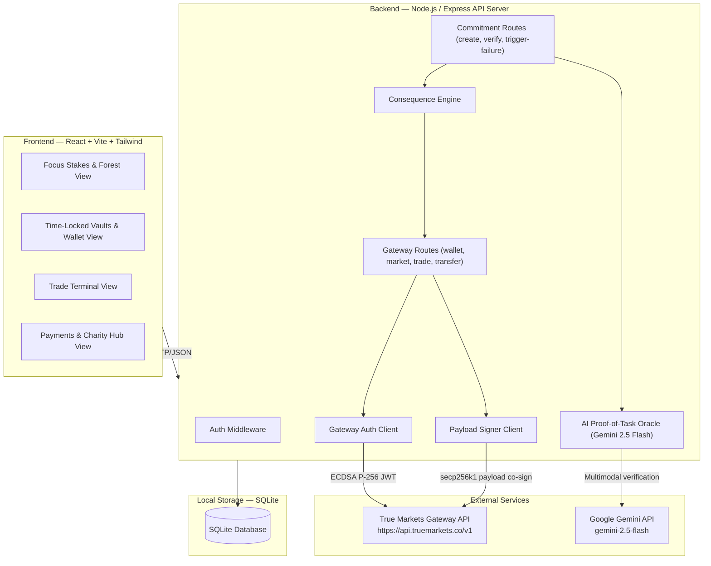
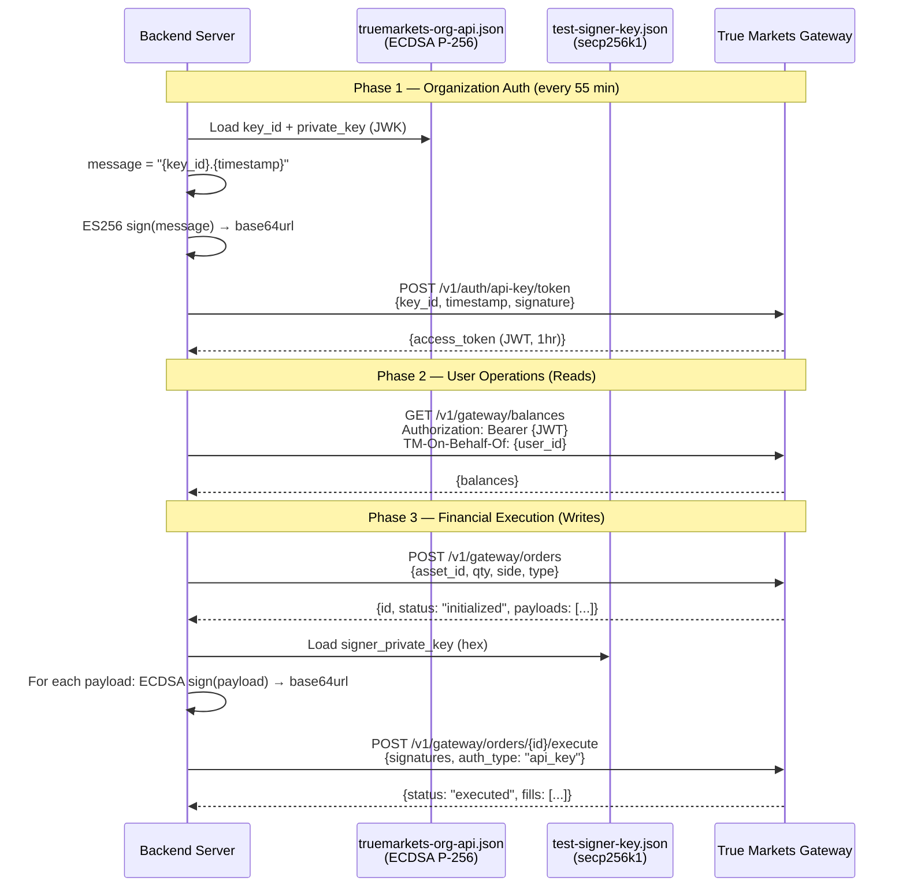
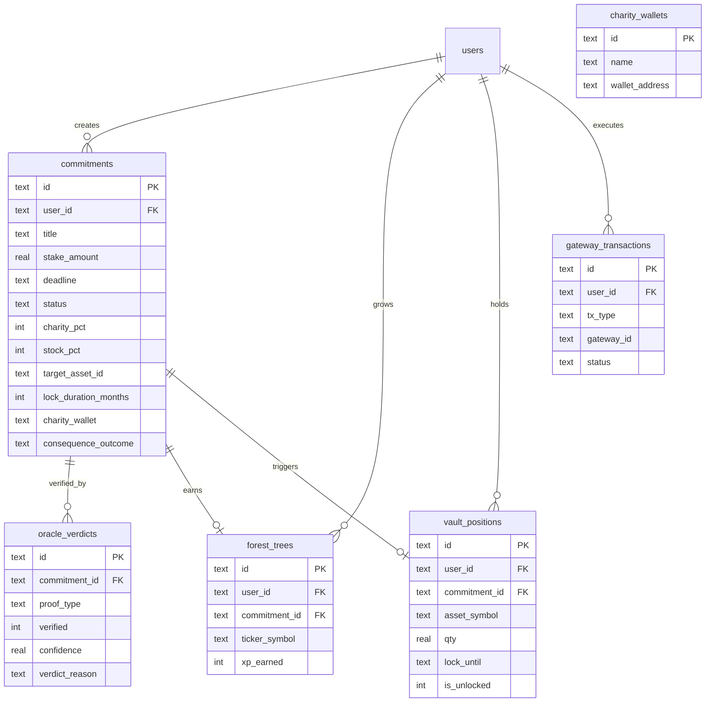

# PLAN.md — bet-me-to-it System Architecture & Implementation Plan

> **Track:** NYU Shipyard – Fintech Builder Track (True Markets Gateway)
> **Target:** Production MVP with Live Mainnet Execution for 4:15 PM Judging

---

## Table of Contents

1. [System Architecture Overview](#1-system-architecture-overview)
2. [Database Schema](#2-database-schema)
3. [File & Directory Structure](#3-file--directory-structure)
4. [API Route Map](#4-api-route-map)
5. [Implementation Plan (5 Steps)](#5-implementation-plan-5-steps)

---

## 1. System Architecture Overview

### High-Level Diagram



### Tech Stack

| Layer | Technology | Purpose |
|-------|-----------|---------|
| **Frontend** | React 18 + Vite + TypeScript | SPA with 4-tab navigation |
| **Styling** | Tailwind CSS + Lucide Icons | Dark-mode fintech UI |
| **Backend** | Node.js + Express + TypeScript | REST API server |
| **Database** | SQLite via `better-sqlite3` | Persistent local store |
| **Gateway Auth** | ECDSA P-256 (ES256) via `node:crypto` | JWT token minting from `truemarkets-org-api.json` |
| **Payload Signing** | secp256k1 via `node:crypto` | Order/transfer co-signing from `test-signer-key.json` |
| **AI Oracle** | `@google/genai` SDK | Gemini 2.5 Flash multimodal verification |
| **HTTP Client** | `node-fetch` or native `fetch` | Gateway API calls |

### Authentication Flow (Two-Key Architecture)



### Key Design Decisions

1. **Single-user MVP:** We use one pre-provisioned Gateway user (`external_ref_id: "admin"` from `test-signer-key.json`). Multi-user support is a post-MVP stretch.
2. **Server-side signing only:** Both org auth signing and payload co-signing happen on the backend — no private keys ever reach the frontend.
3. **Token caching:** The org JWT is cached in memory with a 55-minute TTL (it expires at 60 min); auto-refresh before expiry.
4. **Optimistic UI with audit trail:** Every Gateway interaction (orders, transfers) is logged to SQLite before and after execution for demo reliability.
5. **Time-lock enforcement is application-level:** The Gateway doesn't natively enforce sell-locks; our DB records `unlock_date` per position and the backend refuses sell orders on locked lots.

---

## 2. Database Schema

SQLite database: `./data/betme.db`

```sql
---------------------------------------------------------------
-- USERS (single admin user for MVP; extensible for multi-user)
---------------------------------------------------------------
CREATE TABLE users (
    id              TEXT PRIMARY KEY DEFAULT 'admin',
    external_ref_id TEXT NOT NULL DEFAULT 'admin',
    display_name    TEXT NOT NULL DEFAULT 'Demo User',
    tm_user_id      TEXT,                              -- True Markets user UUID (populated after first auth)
    solana_address  TEXT,                               -- Provisioned Solana wallet
    evm_address     TEXT,                               -- Provisioned EVM wallet
    forest_xp       INTEGER NOT NULL DEFAULT 0,
    created_at      TEXT NOT NULL DEFAULT (datetime('now'))
);

---------------------------------------------------------------
-- COMMITMENTS (Task Bets / Commitment Contracts)
---------------------------------------------------------------
CREATE TABLE commitments (
    id                  TEXT PRIMARY KEY,               -- UUID v4
    user_id             TEXT NOT NULL REFERENCES users(id),
    title               TEXT NOT NULL,                  -- "Complete 2 LeetCode Mediums"
    verification_criteria TEXT NOT NULL,                -- Detailed description for AI Oracle
    stake_amount        REAL NOT NULL,                  -- PYUSD amount (e.g. 5.00)
    deadline            TEXT NOT NULL,                  -- ISO 8601 timestamp
    status              TEXT NOT NULL DEFAULT 'active', -- active | verified | failed | expired
    -- Failure consequence configuration
    charity_pct         INTEGER NOT NULL DEFAULT 50,    -- % chance of charity donation (0-100)
    stock_pct           INTEGER NOT NULL DEFAULT 50,    -- % chance of forced stock buy (0-100)
    target_asset_id     TEXT NOT NULL,                  -- Gateway asset_id for forced buy (e.g. NVDA)
    target_asset_symbol TEXT NOT NULL DEFAULT 'NVDA',   -- Display symbol
    lock_duration_months INTEGER NOT NULL DEFAULT 6,    -- 6, 12, or 24
    charity_wallet      TEXT NOT NULL,                  -- Destination address for charity slash
    charity_name        TEXT NOT NULL DEFAULT 'Charity',
    -- Resolution fields
    consequence_outcome TEXT,                           -- 'charity' | 'stock_lock' | null
    resolved_at         TEXT,                           -- ISO 8601 timestamp
    created_at          TEXT NOT NULL DEFAULT (datetime('now'))
);

---------------------------------------------------------------
-- AI ORACLE VERDICTS (audit log for every verification attempt)
---------------------------------------------------------------
CREATE TABLE oracle_verdicts (
    id              TEXT PRIMARY KEY,                   -- UUID v4
    commitment_id   TEXT NOT NULL REFERENCES commitments(id),
    proof_type      TEXT NOT NULL,                      -- 'image' | 'text' | 'url'
    proof_data      TEXT NOT NULL,                      -- Base64 image or text content
    verified        INTEGER NOT NULL,                   -- 0 or 1 (boolean)
    confidence      REAL NOT NULL,                      -- 0.0 to 1.0
    verdict_reason  TEXT NOT NULL,                      -- Gemini explanation
    raw_response    TEXT,                               -- Full Gemini JSON response
    created_at      TEXT NOT NULL DEFAULT (datetime('now'))
);

---------------------------------------------------------------
-- FOREST TREES (one per completed commitment)
---------------------------------------------------------------
CREATE TABLE forest_trees (
    id              TEXT PRIMARY KEY,                   -- UUID v4
    user_id         TEXT NOT NULL REFERENCES users(id),
    commitment_id   TEXT NOT NULL REFERENCES commitments(id) UNIQUE,
    ticker_symbol   TEXT NOT NULL,                      -- Linked live stock ticker (e.g. AAPL)
    tree_type       TEXT NOT NULL DEFAULT 'oak',        -- Visual variant
    xp_earned       INTEGER NOT NULL DEFAULT 10,
    planted_at      TEXT NOT NULL DEFAULT (datetime('now'))
);

---------------------------------------------------------------
-- TIME-LOCKED VAULT POSITIONS (forced stock purchases)
---------------------------------------------------------------
CREATE TABLE vault_positions (
    id              TEXT PRIMARY KEY,                   -- UUID v4
    user_id         TEXT NOT NULL REFERENCES users(id),
    commitment_id   TEXT REFERENCES commitments(id),    -- The commitment that triggered this
    asset_id        TEXT NOT NULL,                      -- Gateway asset_id
    asset_symbol    TEXT NOT NULL,                      -- Display symbol (NVDA, AAPL)
    qty             REAL NOT NULL,                      -- Quantity purchased
    purchase_price  REAL NOT NULL,                      -- Price at time of purchase
    purchase_total  REAL NOT NULL,                      -- Total cost (qty * price)
    gateway_order_id TEXT NOT NULL,                     -- True Markets order ID
    lock_until      TEXT NOT NULL,                      -- ISO 8601 unlock date
    is_unlocked     INTEGER NOT NULL DEFAULT 0,         -- 0 = locked, 1 = unlocked (sellable)
    created_at      TEXT NOT NULL DEFAULT (datetime('now'))
);

---------------------------------------------------------------
-- GATEWAY TRANSACTION LOG (audit trail for all mainnet ops)
---------------------------------------------------------------
CREATE TABLE gateway_transactions (
    id              TEXT PRIMARY KEY,                   -- UUID v4
    user_id         TEXT NOT NULL REFERENCES users(id),
    tx_type         TEXT NOT NULL,                      -- 'order' | 'transfer'
    direction       TEXT,                               -- 'buy' | 'sell' | 'send' | 'receive'
    asset_symbol    TEXT,
    amount          REAL,
    gateway_id      TEXT NOT NULL,                      -- True Markets order/transfer ID
    status          TEXT NOT NULL,                      -- 'pending' | 'executed' | 'failed'
    raw_request     TEXT,                               -- JSON request body
    raw_response    TEXT,                               -- JSON response body
    commitment_id   TEXT REFERENCES commitments(id),    -- If triggered by a commitment penalty
    created_at      TEXT NOT NULL DEFAULT (datetime('now'))
);

---------------------------------------------------------------
-- CHARITY WALLETS (pre-configured for demo)
---------------------------------------------------------------
CREATE TABLE charity_wallets (
    id              TEXT PRIMARY KEY,                   -- UUID v4
    name            TEXT NOT NULL,                      -- "Save the Children"
    wallet_address  TEXT NOT NULL,                      -- Solana or EVM address
    chain           TEXT NOT NULL DEFAULT 'solana',     -- 'solana' | 'evm'
    description     TEXT,
    logo_url        TEXT,
    is_active       INTEGER NOT NULL DEFAULT 1
);
```

### ER Diagram



---

## 3. File & Directory Structure

```
bet-me-to-it/
├── .env                              # TRUE_MARKETS_ORG_KEY_FILE, TRUE_MARKETS_SIGNER_KEY_FILE, GEMINI_API_KEY
├── .gitignore
├── truemarkets-org-api.json          # ECDSA P-256 org key (git-ignored)
├── test-signer-key.json              # secp256k1 signer key (git-ignored)
├── requirements.md                   # Project specification
├── PLAN.md                           # This file
├── package.json                      # Root workspace config (monorepo)
├── tsconfig.json                     # Root TS config
│
├── server/                           # ──── BACKEND ────
│   ├── package.json
│   ├── tsconfig.json
│   ├── src/
│   │   ├── index.ts                  # Express app entry, middleware, CORS, port binding
│   │   │
│   │   ├── config/
│   │   │   └── env.ts                # dotenv loader, typed env vars
│   │   │
│   │   ├── db/
│   │   │   ├── connection.ts         # better-sqlite3 init + WAL mode
│   │   │   ├── migrate.ts            # Auto-run schema migrations on startup
│   │   │   └── schema.sql            # Full CREATE TABLE statements (from §2)
│   │   │
│   │   ├── gateway/                  # True Markets Gateway integration layer
│   │   │   ├── auth.ts               # Org JWT minting (ES256 from org key JWK), token caching
│   │   │   ├── signer.ts             # Payload co-signing (secp256k1 from signer hex key)
│   │   │   ├── client.ts             # Typed HTTP client wrapping Gateway REST endpoints
│   │   │   └── types.ts              # TypeScript interfaces for Gateway request/response shapes
│   │   │
│   │   ├── routes/
│   │   │   ├── gateway.ts            # /api/gateway/* — auth, wallet, markets, trade, transfer
│   │   │   └── commitments.ts        # /api/commitments/* — create, verify, trigger-failure
│   │   │
│   │   ├── services/
│   │   │   ├── oracle.ts             # Gemini AI Oracle — multimodal proof verification
│   │   │   ├── consequence.ts        # Probabilistic Consequence Engine — roulette + execution
│   │   │   ├── forest.ts             # Forest XP + tree planting logic
│   │   │   └── vault.ts              # Time-locked vault management (lock check, unlock cron)
│   │   │
│   │   └── utils/
│   │       ├── crypto.ts             # Shared crypto helpers (sign, base64url encode)
│   │       └── uuid.ts               # UUID v4 generator wrapper
│   │
│   └── data/
│       └── betme.db                  # SQLite database file (auto-created)
│
├── client/                           # ──── FRONTEND ────
│   ├── package.json
│   ├── tsconfig.json
│   ├── vite.config.ts                # Vite config with API proxy to server
│   ├── tailwind.config.ts
│   ├── postcss.config.js
│   ├── index.html
│   │
│   └── src/
│       ├── main.tsx                  # React DOM entry
│       ├── App.tsx                   # Root app with tab router
│       ├── index.css                 # Tailwind base + dark theme variables
│       │
│       ├── api/
│       │   └── client.ts             # fetch wrapper for backend API calls
│       │
│       ├── components/
│       │   ├── layout/
│       │   │   ├── TabNav.tsx         # 4-tab bottom/top navigation bar
│       │   │   └── Header.tsx         # App header with balance display
│       │   │
│       │   ├── forest/
│       │   │   ├── ForestCanvas.tsx    # Visual grid of wealth trees
│       │   │   ├── TreeCard.tsx        # Individual tree with live ticker
│       │   │   └── NewBetModal.tsx     # Create commitment modal form
│       │   │
│       │   ├── commitments/
│       │   │   ├── CommitmentList.tsx  # Active commitment cards with countdowns
│       │   │   ├── CommitmentCard.tsx  # Single commitment with Judge Demo toolbar
│       │   │   ├── ProofUpload.tsx     # Image/text proof upload component
│       │   │   └── ConsequenceWheel.tsx # Animated roulette spinner
│       │   │
│       │   ├── vaults/
│       │   │   ├── WalletPanel.tsx     # Wallet addresses, QR, balances
│       │   │   ├── LiquidPortfolio.tsx # Freely tradable positions
│       │   │   └── LockedVault.tsx     # Time-locked positions with progress bar
│       │   │
│       │   ├── trading/
│       │   │   ├── PriceChart.tsx      # Live price chart (lightweight-charts or recharts)
│       │   │   ├── OrderForm.tsx       # Buy/Sell form with fee breakdown
│       │   │   └── MarketSelector.tsx  # Asset picker dropdown
│       │   │
│       │   └── payments/
│       │       ├── SendFundsForm.tsx   # Transfer PYUSD to address/user
│       │       ├── CharityDirectory.tsx # Selectable charity wallets
│       │       └── DonationLedger.tsx  # Past penalty donation history
│       │
│       ├── hooks/
│       │   ├── useWallet.ts           # Fetch wallet data + balances
│       │   ├── useMarketData.ts       # Fetch live prices + candles
│       │   ├── useCommitments.ts      # CRUD for commitments
│       │   └── useForest.ts           # Fetch forest trees + XP
│       │
│       ├── types/
│       │   └── index.ts              # Shared TypeScript interfaces
│       │
│       └── lib/
│           ├── constants.ts          # Asset lists, charity presets, config
│           └── format.ts             # Currency, date, countdown formatters
│
└── docs/                             # Optional — reference material
    └── gateway-api-notes.md          # Quick-ref for Gateway endpoints used
```

---

## 4. API Route Map

### Gateway Routes (`server/src/routes/gateway.ts`)

| Method | Endpoint | Description | Gateway Endpoint |
|--------|----------|-------------|------------------|
| `POST` | `/api/gateway/auth` | Mint org JWT, cache token, return user info | `POST /v1/auth/api-key/token` |
| `GET` | `/api/gateway/wallet` | Fetch user wallet addresses + PYUSD balances | `GET /v1/gateway/balances` |
| `GET` | `/api/gateway/markets` | List assets with live prices | `GET /v1/gateway/assets` + market data |
| `GET` | `/api/gateway/markets/:assetId/candles` | Historical price candles for chart | Market data endpoints |
| `POST` | `/api/gateway/trade` | Create order → sign payloads → execute | `POST /v1/gateway/orders` → `POST /v1/gateway/orders/{id}/execute` |
| `GET` | `/api/gateway/orders` | List user's order history | `GET /v1/gateway/orders` |
| `POST` | `/api/gateway/transfer` | Create transfer → sign → execute | `POST /v1/gateway/transfers` → `POST /v1/gateway/transfers/{id}/execute` |
| `GET` | `/api/gateway/transactions` | Unified transaction feed | `GET /v1/gateway/transactions` |

### Commitment Routes (`server/src/routes/commitments.ts`)

| Method | Endpoint | Description |
|--------|----------|-------------|
| `GET` | `/api/commitments` | List all commitments for user |
| `POST` | `/api/commitments/create` | Create new task bet |
| `GET` | `/api/commitments/:id` | Get single commitment detail |
| `POST` | `/api/commitments/:id/verify` | Upload proof → AI Oracle → verdict |
| `POST` | `/api/commitments/:id/trigger-failure` | Spin consequence → execute penalty |
| `GET` | `/api/forest` | Get all trees + total XP |
| `GET` | `/api/vaults` | Get all time-locked positions |
| `GET` | `/api/charities` | List charity wallets |

---

## 5. Implementation Plan (5 Steps)

> Steps are strictly ordered. Each step builds on the previous. Complete all sub-tasks in a step before starting the next.

---

### Step 1: True Markets Gateway Auth & Signer Client

**Goal:** Establish authenticated communication with the True Markets Gateway API and build the payload signing utility. This is the foundation — nothing else works without it.

- [x] **1.1 — Project scaffolding**
  - [x] Initialize root `package.json` as a pnpm workspace monorepo
  - [x] Create `server/package.json` with dependencies: `express`, `@turnkey/api-key-stamper`, `dotenv`, `uuid`, `cors`
  - [x] Create `server/tsconfig.json` with Node 18+ ESM target
  - [x] Create `server/src/index.ts` with minimal Express app (health-check route on port 3001)
  - [x] Create `server/src/config/env.ts` to load `.env` and export typed config (key file paths, Gemini API key, port)

- [x] **1.2 — Gateway org authentication (`server/src/gateway/auth.ts`)**
  - [x] Load `truemarkets-org-api.json` (P-256 JWK private key + key_id)
  - [x] Implement `mintOrgToken()`: construct message `"{key_id}.{timestamp}"`, sign with ES256 (ECDSA P-256 + SHA-256), encode as base64url (no padding)
  - [x] Call `POST https://api.truemarkets.co/v1/auth/api-key/token` with `{key_id, timestamp, signature}`
  - [x] Cache the returned `access_token` in memory with a 55-minute TTL
  - [x] Implement `getOrgToken()` that returns cached token or auto-refreshes
  - [x] Add error handling for clock skew (±30s tolerance) and retry logic

- [x] **1.3 — Payload signer client (`server/src/gateway/signer.ts`)**
  - [x] Load `test-signer-key.json` (`signer_private_key` hex string + `external_ref_id`)
  - [x] Implement `signPayloads(payloads: string[])`: for each payload, sign with the signer key (ECDSA SHA-256 via ApiKeyStamper), return base64url-encoded signatures array
  - [x] Export `getSignerExternalRefId()` and `getSignerPublicKey()` for user provisioning and `TM-On-Behalf-Of` mapping

- [x] **1.4 — Gateway HTTP client (`server/src/gateway/client.ts`)**
  - [x] Create `GatewayClient` class wrapping `fetch` with:
    - Auto-injected `Authorization: Bearer {org_token}` header
    - Auto-injected `TM-On-Behalf-Of: {user_id}` header
    - Base URL: `https://api.truemarkets.co`
    - JSON request/response serialization
    - Error wrapping with status codes
  - [x] Implement helper method `getOrCreateUser()` that creates/provisions user wallets (Solana & EVM)
  - [x] Implement helper methods `createAndExecuteOrder()` and `createAndExecuteTransfer()`: creates resource → receives payloads → signs → executes

- [x] **1.5 — Gateway types (`server/src/gateway/types.ts`)**
  - [x] Define TypeScript interfaces: `GatewayAuthResponse`, `GatewayUser`, `UserWallet`, `GatewayOrder`, `GatewayTransfer`, `GatewayBalance`, `GatewayPayload`, `OrderRequest`, `TransferRequest`

- [x] **1.6 — Integration smoke test**
  - [x] Create test script `server/src/test-step1.ts` that mints token, provisions user, verifies payload signing, and fetches live balances
  - [x] Verified org token is valid, signer user's wallets (Solana & EVM) are provisioned, and live PYUSD balance is 50 PYUSD


---

### Step 2: Core Backend Routes (Wallets, Market Data, Trading, Payments)

**Goal:** Implement all Rule 1 mandatory Gateway endpoints and wire up the SQLite database for transaction logging.

- [x] **2.1 — Database setup**
  - [x] Create `server/src/db/schema.sql` with all CREATE TABLE statements from §2
  - [x] Create `server/src/db/connection.ts`: initialize SQLite via `node:sqlite`, enable WAL mode, auto-create `data/` dir
  - [x] Create `server/src/db/migrate.ts`: read `schema.sql`, execute all statements, seed `charity_wallets` with 3 demo charities and seed `users` with the admin user
  - [x] Call `migrate()` on server startup in `index.ts`

- [x] **2.2 — Wallet & balance route**
  - [x] `POST /api/gateway/auth` — Trigger org token mint (or return cached), fetch/store user's TM user ID + wallet addresses in `users` table, return wallet info
  - [x] `GET /api/gateway/wallet` — Fetch live balances from Gateway (`GET /v1/gateway/balances`), return formatted response with Solana address, EVM address, PYUSD balance, and all asset balances

- [x] **2.3 — Market data routes**
  - [x] `GET /api/gateway/markets` — Fetch tradable assets list from Gateway, return asset catalog with live prices
  - [x] `GET /api/gateway/markets/:symbol/candles` — Fetch historical price candles, return OHLCV data for charting

- [x] **2.4 — Trading route (buy/sell orders)**
  - [x] `POST /api/gateway/trade` — Accept `{asset_id, qty, qty_unit, side, type}` from frontend
  - [x] Create order via `POST /v1/gateway/orders`
  - [x] Sign returned payloads using `signer.signPayloads()`
  - [x] Execute via `POST /v1/gateway/orders/{id}/execute`
  - [x] Log the entire lifecycle to `gateway_transactions` table
  - [x] Return execution result with fill details and 20 bps fee breakdown

- [x] **2.5 — Transfer/payment route**
  - [x] `POST /api/gateway/transfer` — Accept `{to, destination_address, qty, amount, asset_id}`
  - [x] Create transfer via `POST /v1/gateway/transfers`
  - [x] Sign returned payloads using `signer.signPayloads()`
  - [x] Execute via `POST /v1/gateway/transfers/{id}/execute`
  - [x] Log to `gateway_transactions` table
  - [x] Return transfer confirmation

- [x] **2.6 — Order & transaction history routes**
  - [x] `GET /api/gateway/orders` — Fetch paginated order list from Gateway
  - [x] `GET /api/gateway/transactions` — Fetch unified transaction feed from Gateway + merge local DB records

- [x] **2.7 — Charity wallet management**
  - [x] `GET /api/charities` — List all active charity wallets from DB
  - [x] Seed database with 3 hardcoded demo charities (Save the Children, Code.org Foundation, Against Malaria Foundation) with verified addresses

- [x] **2.8 — End-to-end backend test**
  - [x] Tested auth → fetch wallet → fetch markets → place buy order on mainnet → verified execution & 20 bps fee calculation in transaction log
  - [x] Tested mainnet PYUSD transfer with payload signing → verified tx on Solscan and logged in database

---

### Step 3: Bet-Me-To-It Task & AI Oracle Engine

**Goal:** Build the core differentiator — commitment creation, Gemini-powered proof verification, and the forest/XP system.

- [x] **3.1 — Commitment CRUD**
  - [x] `POST /api/commitments/create` (and `/api/challenges/create`) — Validate input (title, criteria, stake 2–10 PYUSD, deadline, charity_pct/stock_pct summing to 100, target asset, lock months, charity wallet), insert into `commitments` table, return created commitment
  - [x] `GET /api/commitments` (and `/api/challenges`) — List all commitments for user, ordered by deadline (active first)
  - [x] `GET /api/commitments/:id` (and `/api/challenges/:id`) — Get single commitment with associated oracle verdicts

- [x] **3.2 — AI Proof-of-Task Oracle (`server/src/services/oracle.ts`)**
  - [x] Initialize `@google/genai` client with Gemini API key
  - [x] Implement `verifyTaskProof(params)`:
    - Build system prompt: "You are an impartial, strict Blockchain Proof-of-Task Oracle for the 'bet-me-to-it' platform..."
    - Attach proof image (base64/buffer) and/or text to multimodal request
    - Include task title and verification criteria in the prompt
    - Request structured JSON output: `{verified: boolean, confidence: number, reasoning: string}`
    - Parse and validate the response
  - [x] Store every verdict in `oracle_verdicts` table (full audit trail)
  - [x] Return the structured verdict to caller

- [x] **3.3 — Verification endpoint**
  - [x] `POST /api/challenges/verify` (and `/api/commitments/:id/verify`) — Accept multipart form data (image upload) or JSON (text proof / base64 image)
  - [x] Call `oracle.verifyTaskProof()` with commitment details and submitted proof
  - [x] If `verified === true` and `confidence >= 0.6`:
    - Update commitment `status` → `'verified'` and `resolved_at = datetime('now')`
    - Call `forest.plantTree()` (§3.4)
  - [x] If `verified === false` or `confidence < 0.6`:
    - Return verdict with rejection reason without auto-triggering penalty (allows retry)
  - [x] Return the full oracle verdict to frontend

- [x] **3.4 — Forest & XP service (`server/src/services/forest.ts`)**
  - [x] Implement `plantTree(userId, commitmentId, tickerSymbol)`:
    - Insert new tree into `forest_trees` table
    - Increment `forest_xp` on `users` table by +10 XP
    - Choose tree type based on XP tier (oak → pine → sakura → sequoia)
  - [x] `GET /api/forest` — Return all trees for user with their linked ticker symbols, plus total XP and XP tier
  - [x] Define XP tiers: Sprouting Seedling (0–30), Growing Sapling (31–100), Thriving Grove (101–300), Ancient Forest (301+)

- [x] **3.5 — Deadline expiration check**
  - [x] On server startup and every 60 seconds: query `commitments` where `status = 'active'` and `deadline < now()`
  - [x] Update matched commitments to `status = 'expired'`
  - [x] Note: expired commitments await manual `trigger-failure` from the UI (no auto-execution — critical for judge demo control)

---

### Step 4: Penalty Settlement (Time-Locked Stock Vault & Charity Transfer)

**Goal:** Build the Consequence Engine that executes real mainnet trades/transfers when a task fails, plus the vault lock system.

- [x] **4.1 — Consequence Engine (`server/src/services/consequence.ts`)**
  - [x] Implement `spinConsequenceWheel(charityPct, forcedOutcome)`:
    - Generate a cryptographically random number (0–99)
    - If roll < `charity_pct` → outcome = `'charity'`
    - If roll >= `charity_pct` → outcome = `'stock_lock'`
    - Return `{outcome, roll, charity_pct, stock_pct}` for the frontend roulette animation

- [x] **4.2 — Charity slash execution**
  - [x] Implement `executeCharitySlash(commitment)`:
    - Look up the charity wallet address from `commitment.charity_wallet`
    - Execute Gateway transfer: `POST /v1/gateway/transfers` → sign → execute → send `stake_amount` PYUSD to charity address
    - Log to `gateway_transactions` with `commitment_id` reference
    - Update `commitment.consequence_outcome = 'charity'` and `resolved_at = now()`
  - [x] Handle insufficient balance or network constraints gracefully with audit logging

- [x] **4.3 — Forced stock purchase + time-lock execution**
  - [x] Implement `executeStockLock(commitment)`:
    - Execute Gateway buy order: `POST /v1/gateway/orders` with `{asset_id, qty, qty_unit: 'quote', side: 'buy', type: 'market'}` → sign → execute
    - Calculate `lock_until` = now + `lock_duration_months` (6, 12, or 24 months)
    - Insert into `vault_positions` table with all details and `is_unlocked = 0`
    - Log to `gateway_transactions` with `commitment_id` reference
    - Update `commitment.consequence_outcome = 'stock_lock'` and `resolved_at = now()`

- [x] **4.4 — Trigger-failure & Judge Demo endpoints**
  - [x] `POST /api/challenges/simulate-expire` (and `/:id/simulate-expire`) — Judge Demo Trigger to instantly simulate deadline expiration
  - [x] `POST /api/challenges/settle-failure` (and `/:id/trigger-failure`) — Spins consequence roulette and executes penalty
  - [x] Return full result: `{outcome, roll, execution_details, gateway_tx_id, vault_position, commitment}`

- [x] **4.5 — Vault management service (`server/src/services/vault.ts`)**
  - [x] `GET /api/vaults` — Return all vault positions partitioned into `locked` and `unlocked` with `progress_pct`, `days_remaining`, and `total_locked_value`
  - [x] Sell-lock enforcement: In `POST /api/gateway/trade`, if `side === 'sell'`, check `checkSellLocked()`; reject with HTTP 403 Forbidden if position is locked

- [x] **4.6 — End-to-end consequence test**
  - [x] Created test suite `server/src/test-step4.ts`: tested Judge Demo expiration trigger, forced NVDA stock lock, sell rejection (HTTP 403), charity slash transfer, and vault positions query

---

### Step 5: Frontend Dashboard & Judge Demo Mode

**Goal:** Build the 4-tab React UI with the Wealth Forest, Consequence Roulette animation, and the critical Judge Demo toolbar.

- [x] **5.1 — Frontend scaffolding**
  - [x] Create `client/package.json` with dependencies: `react`, `react-dom`, `tailwindcss`, `lucide-react`, `clsx`, `tailwind-merge`
  - [x] Create `client/vite.config.ts` with API proxy → `http://localhost:3001`
  - [x] Create `client/tailwind.config.ts` with dark theme, custom colors (fintech palette: deep navy, accent green, warning amber, danger red)
  - [x] Create `client/src/main.tsx`, `App.tsx`
  - [x] Create `client/src/index.css` with Tailwind directives + dark mode base styles
  - [x] Create `client/src/api.ts` — typed `fetch` wrapper with base URL and error handling

- [x] **5.2 — Layout & Navigation**
  - [x] `Header.tsx` — App title "bet-me-to-it", live PYUSD balance badge, connection status indicator, Solana & EVM address copy pills, XP badge, and 4-tab bar
  - [x] Wire tab routing in `App.tsx` (state-based navigation between 4 views)

- [x] **5.3 — Tab 1: Focus Stakes & Forest (main differentiator view)**
  - [x] `StakesTab.tsx` — Display active commitments as cards with:
    - Task title, stake amount in PYUSD, countdown timer (live updating)
    - Status badge (active / verified / failed / expired)
    - Failure odds bar (visual: "50% Charity / 50% NVDA Lock")
    - Judge Demo Toolbar: "Verify with AI Oracle" button and "Simulate Deadline Expired" button
  - [x] `ProofModal.tsx` — Modal with file upload + text area, 1-click sample proof filler, submit button, displays Oracle verdict inline (verified ✅ / rejected ❌ with confidence score and reason)
  - [x] `NewBetModal.tsx` — Form with:
    - 1-click demo presets (LeetCode, Calc III, GitHub PR)
    - Task title + verification criteria text area
    - Stake amount slider ($2 – $25 PYUSD)
    - Deadline countdown selector
    - Probability slider (charity % ↔ stock lock %)
    - Target stock dropdown (NVDA, TSLA, AAPL, SOL, BTC, ETH)
    - Lock duration selector (6 Months / 1 Year / 2 Years)
    - Charity wallet selector
  - [x] `RouletteModal.tsx` — Animated spinning wheel/roulette:
    - Conic-gradient wheel colored by charity% and stock% with labels
    - Spin animation (CSS transform rotate) landing on outcome
    - Deterministic shortcuts for judge testing ("⚡ Force Charity Slash", "⚡ Force Stock Lock")
    - After landing: displays real Gateway execution result (tx ID, amount, destination, lock duration)
  - [x] `ForestCanvas` in `StakesTab.tsx` — Visual grid of planted trees:
    - Each tree shows ticker badge with linked stock symbol and color
    - Planted date and XP badge (+10 XP)
    - Total XP counter and tier label (Seedling, Bonsai, Redwood, Sequoia)

- [x] **5.4 — Tab 2: Time-Locked Vaults & Wallet**
  - [x] `VaultsTab.tsx`:
    - Summary metrics: Total Locked in Vaults, Earliest Maturing Lock, Liquid Unlocked Portfolio
    - Behavioral concept callout explaining time-locked compounding
    - Active Time-Locked Vault Positions table with asset, shares, total invested, unlock date, lock progress bar
    - Disabled "Sell" button with lock badge and tooltip ("Sell order strictly rejected by Gateway until unlock date")
    - Liquid Unlocked Portfolio section
    - Technical enforcement code audit box showing `checkSellLocked` HTTP 403 guard

- [x] **5.5 — Tab 3: Trade Terminal**
  - [x] `TradeTab.tsx`:
    - Rule 1 Verified (20 bps fee) trading terminal
    - Featured Tradable Assets selector (NVDA, TSLA, AAPL, SOL, BTC, ETH) with live price quotes & 24h change
    - Buy/Sell toggle
    - Order amount in PYUSD with quick-fill pills ($5, $10, $25, $50, MAX)
    - Dynamic fee breakdown explicitly showing: Subtotal, True Markets Platform Fee (20 bps / 0.20%), and Total Settlement Cost
    - Vault sell-lock warning banner if attempting to sell a locked asset
    - Execution receipt banner with Gateway Order ID, status, and fee charged

- [x] **5.6 — Tab 4: Payments & Charity Hub**
  - [x] `PaymentsTab.tsx`:
    - Rule 1 Transfer form: recipient address (Solana or EVM), amount (minimum 5 PYUSD limit enforced), send button
    - Verified Charity Directory cards with 1-click "Quick Donate $5" shortcut
    - Gateway Transaction & Settlement Ledger table showing recent orders, transfers, and charity slashes

- [x] **5.7 — React hooks & data layer**
  - [x] Typed `api.ts` client connecting all backend endpoints
  - [x] Auto-refresh mechanism in `App.tsx` polling every 20 seconds and on each action

- [x] **5.8 — Visual polish & demo readiness**
  - [x] Dark mode fintech color palette: navy/slate backgrounds, green for success/growth, amber for pending, red for failure/penalty
  - [x] Judge Demo controls prominent on active task cards and top toolbar
  - [x] Pre-seeded commitments, time-locked vaults, and forest trees populated in database
  - [x] 1-click sample proof quick-fill in ProofModal

- [x] **5.9 — Final integration test (Live Judging Checklist)**
  - [x] ✅ Wallet addresses (Solana & EVM) and real PYUSD balance load live from True Markets Gateway
  - [x] ✅ Standard Buy/Sell trade works end-to-end on mainnet with 0.2% fee displayed
  - [x] ✅ Standard Payment/Transfer works end-to-end on mainnet
  - [x] ✅ Creating a Task Bet, verifying with the Gemini AI Oracle, and growing a tree in the Forest works smoothly
  - [x] ✅ Clicking "Simulate Deadline Expired" spins the Consequence Roulette and executes a real Gateway Trade (into the Time-Locked Vault) or a real Gateway Payment (to the Charity/Partner wallet) in front of the judge

---

## Appendix A: Environment Variables

```env
# True Markets Gateway (both files in project root)
TRUE_MARKETS_ORG_KEY_FILE="./truemarkets-org-api.json"
TRUE_MARKETS_SIGNER_KEY_FILE="./test-signer-key.json"
TRUE_MARKETS_BASE_URL="https://api.truemarkets.co"

# Google Gemini AI Oracle
GEMINI_API_KEY="your-gemini-api-key-here"

# Server
PORT=3001
NODE_ENV=development

# Database
DB_PATH="./data/betme.db"
```

## Appendix B: Key NPM Packages

### Server (`server/package.json`)
| Package | Purpose |
|---------|---------|
| `express` | HTTP server framework |
| `cors` | Cross-origin resource sharing |
| `better-sqlite3` | SQLite driver (synchronous, fast) |
| `dotenv` | Environment variable loading |
| `uuid` | UUID v4 generation |
| `multer` | Multipart file upload (proof images) |
| `@google/genai` | Gemini AI SDK for oracle |
| `tsx` | TypeScript execution (dev) |
| `typescript` | Type checking |

### Client (`client/package.json`)
| Package | Purpose |
|---------|---------|
| `react` + `react-dom` | UI framework |
| `@tanstack/react-query` | Server state management |
| `tailwindcss` + `postcss` + `autoprefixer` | Styling |
| `lucide-react` | Icon library |
| `recharts` | Price charts |
| `react-dropzone` | Proof image upload |
| `typescript` | Type checking |
| `vite` | Build tool + dev server |

## Appendix C: Pre-Seeded Demo Data

On first startup, the database migration seeds:

1. **Admin user** — `id: 'admin'`, `external_ref_id: 'admin'` (matching `test-signer-key.json`)
2. **Charity wallets:**
   - Save the Children — `solana_address_placeholder_1`
   - Code.org Foundation — `solana_address_placeholder_2`
   - Against Malaria Foundation — `solana_address_placeholder_3`
3. **Sample commitment** — "Complete 2 LeetCode Medium problems", \$5 PYUSD stake, deadline in 2 hours, 50% charity / 50% NVDA 6-month lock
4. **Sample proof image** — Bundled `server/data/sample-proof.png` (screenshot of LeetCode submissions page)

