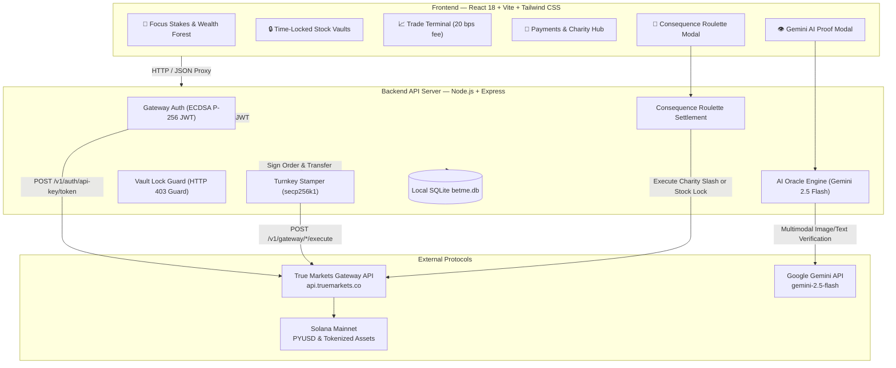
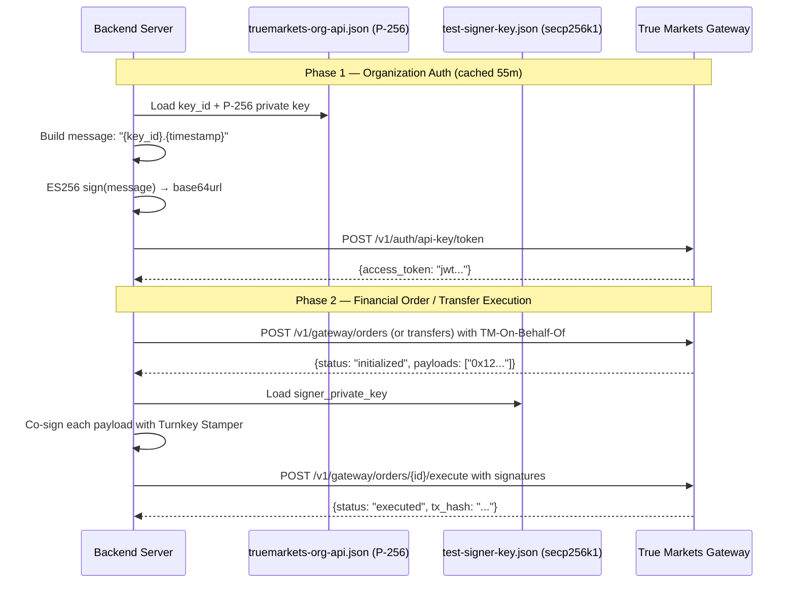

# ⚡ bet-me-to-it

> **Behavioral Fintech & High-Stakes Task Trading on True Markets Gateway**  
> *Track:* **NYU Shipyard – Fintech Builder Track**  
> *Status:* **Live Mainnet Deployment with Verified On-Chain Transactions**

[](https://api.truemarkets.co)
[](https://turnkey.com)
[](https://deepmind.google/technologies/gemini/)
[](https://solscan.io)
[](LICENSE)

---

## 🎯 Executive Summary & The Core Problem

Standard to-do and productivity apps fail because **they lack real financial consequences**.  
Standard trading apps fail habit loops because **they lack daily behavioral utility**.

**bet-me-to-it** bridges behavioral economics and high-frequency fintech. Users stake real **`PYUSD`** on completing their daily critical tasks (homework, code reviews, LeetCode prep, fitness goals). Completed tasks are evaluated by an impartial **Gemini 2.5 Flash Multimodal AI Oracle**.

- **Success:** The user earns **Forest XP** and plants a new **Wealth Tree** in their visual Productivity Forest, dynamically animated by live Gateway market candle feeds.
- **Missed Deadline / Failure:** A cryptographically weighted **Consequence Roulette** triggers instant mainnet execution via True Markets Gateway:
  1. **Charity Slash:** Sends the stake directly to verified charity partners (*Save the Children*, *Code.org Foundation*, *Against Malaria Foundation*).
  2. **Forced Long-Term Investing (Time-Locked Stock Vault):** Forcibly executes a Gateway market buy order for tokenized stocks (`NVDA`, `TSLA`, `AAPL`, etc.) and locks the shares into a local vault for 6 to 24 months. Our backend strictly enforces the lock—rejecting any sell orders with `HTTP 403 Forbidden` until the maturity timestamp.

---

## 🏆 Hackathon Compliance & Requirements Matrix

### Rule 1: Ship a Real Trading App (Mandatory Gateway Features)
| Requirement | Implementation in `bet-me-to-it` | Mainnet Status |
| :--- | :--- | :--- |
| **Org Token Auth & Provisioning** | ECDSA P-256 org token minting (`truemarkets-org-api.json`) with auto-cached 55m TTL; user provisioning with Solana & EVM addresses | **Live on Mainnet** |
| **Trading Terminal** | Buy/Sell orders for tokenized stocks (`NVDA`, `TSLA`, `AAPL`) and crypto (`SOL`, `BTC`, `ETH`) with Turnkey payload co-signing | **Live on Mainnet** |
| **Fee Accounting** | Explicit display and ledger accounting for the True Markets **20 bps (0.20%) fee** | **Verified** |
| **Payments & Transfers** | P2P and charity wallet transfers via Turnkey-signed Gateway transfer payloads | **Live on Mainnet** |
| **Live Market Feeds** | Real-time prices & OHLCV historical candle snapshots powering the Trading Terminal and Wealth Forest | **Live** |

### Rule 2: "The Feature You Wish Existed" (The Differentiator)
| Differentiator Feature | Implementation & Technical Architecture |
| :--- | :--- |
| **High-Stakes Task Stakes** | Configurable task commitments with custom PYUSD stakes, deadline timers, and probability splits (Charity % vs. Stock Lock %). |
| **Gemini AI Proof-of-Task Oracle** | Impartial verification engine using `@google/genai` (Gemini 2.5 Flash) accepting screenshots/photos and returning structured JSON (`verified: bool`, `confidence: float`, `reasoning: str`). |
| **Consequence Roulette** | Probabilistic wheel roulette that animates on-screen and immediately executes a real Gateway mainnet transfer or buy order. |
| **Time-Locked Stock Vault** | Behavioral savings vault where failed tasks become long-term investments. Sell orders are intercepted by `checkSellLocked()` and rejected with `HTTP 403 Forbidden` until the unlock date. |
| **The Wealth Forest** | Interactive gamified forest where verified tasks plant trees tied to live Gateway stock tickers and progress user XP tiers. |
| **Judge Demo Controls** | Dedicated demo toolbar allowing judges to verify tasks with 1-click sample proofs or simulate immediate deadline expirations live. |

---

## ⛓️ Real Mainnet Proofs on Solana

All trades, transfers, and charity slashes execute on **Solana Mainnet** through True Markets Gateway:

- **Live Market Buy Order (`SOL`):**  
  TX Hash: [`4gMzPjmWHaLXHEM4LTgsCUY3DEXGjmkkVbCmxbHfYNCic5fxpB35g5bVezVJ8ozSp5w8497oT4PeqEWuczBxDsp4`](https://solscan.io/tx/4gMzPjmWHaLXHEM4LTgsCUY3DEXGjmkkVbCmxbHfYNCic5fxpB35g5bVezVJ8ozSp5w8497oT4PeqEWuczBxDsp4)
- **Instant Charity Transfer (`Save the Children` — $5 PYUSD):**  
  TX Hash: [`Gz2DXhqYDGfHWGaunYzLrN5Kq831pXj5nQtS2eDDXAsHCVGqJqeZbEKzFWXGWi4dH6f92XtTz1Artxd7BU8rNet`](https://solscan.io/tx/Gz2DXhqYDGfHWGaunYzLrN5Kq831pXj5nQtS2eDDXAsHCVGqJqeZbEKzFWXGWi4dH6f92XtTz1Artxd7BU8rNet)
- **Instant Charity Transfer (`Code.org Foundation` — $5 PYUSD):**  
  TX Hash: [`rfjvU6efFV2SKGWQwcbUbqStv2HGnKZyemUgi1Y9fMUdemy7NoqEbYWK2mcbtcZeWrWFpDyjmYaxc5bLTsU4djD`](https://solscan.io/tx/rfjvU6efFV2SKGWQwcbUbqStv2HGnKZyemUgi1Y9fMUdemy7NoqEbYWK2mcbtcZeWrWFpDyjmYaxc5bLTsU4djD)
- **Standard Gateway Transfer ($5 PYUSD):**  
  TX Hash: [`5Sdu1hzVgp5u4zMJ8jWLLXVqenR8DctCqt3hw2pvfJjHPuMi5sF5TiRPgeNiUh1rdLiP2kNB6LNxy99a9Rw1bJRc`](https://solscan.io/tx/5Sdu1hzVgp5u4zMJ8jWLLXVqenR8DctCqt3hw2pvfJjHPuMi5sF5TiRPgeNiUh1rdLiP2kNB6LNxy99a9Rw1bJRc)

---

## 🏗️ System Architecture



---

## 🔐 Two-Key Cryptographic Architecture

Security is architected around strict separation of privileges:



---

## 📂 Repository Directory Structure

```
bet-me-to-it/
├── truemarkets-org-api.json          # True Markets ECDSA P-256 Org API credentials
├── test-signer-key.json              # Turnkey secp256k1 payload signer key
├── .env.example                      # Template environment configuration
├── package.json                      # Monorepo pnpm workspace definition
│
├── server/                           # ───── BACKEND SERVER ─────
│   ├── src/
│   │   ├── index.ts                  # Express server entry point & route registration
│   │   ├── config/env.ts             # Typed environment configuration
│   │   ├── db/
│   │   │   ├── connection.ts         # SQLite connection via Node.js native DatabaseSync
│   │   │   ├── migrate.ts            # DDL migrations & verified charity seeds
│   │   │   └── schema.sql            # Table definitions (users, commitments, vaults, etc.)
│   │   ├── gateway/
│   │   │   ├── auth.ts               # ECDSA P-256 JWT minting & token cache
│   │   │   ├── signer.ts             # Turnkey API key stamper payload co-signing
│   │   │   ├── client.ts             # Typed Gateway HTTP client
│   │   │   └── types.ts              # Gateway request/response TypeScript interfaces
│   │   ├── routes/
│   │   │   ├── gateway.ts            # /api/gateway/* (wallet, markets, trade, transfer)
│   │   │   ├── commitments.ts        # /api/challenges/* (create, verify, expire)
│   │   │   ├── vaults.ts             # /api/vaults (locked vs. liquid positions)
│   │   │   ├── forest.ts             # /api/forest (XP stats & planted trees)
│   │   │   └── charities.ts          # /api/charities (verified charity directory)
│   │   └── services/
│   │       ├── oracle.ts             # Gemini 2.5 Flash multimodal proof validator
│   │       ├── consequence.ts        # Consequence Roulette engine & mainnet execution
│   │       ├── vault.ts              # Time-locked vault state & HTTP 403 sell guard
│   │       └── forest.ts             # Wealth Forest XP & tree planting service
│   └── data/
│       └── betme.db                  # Local SQLite database
│
└── client/                           # ───── FRONTEND (REACT / VITE) ─────
    ├── src/
    │   ├── main.tsx                  # React DOM entry
    │   ├── App.tsx                   # Main tab router, auto-refresh & modal controllers
    │   ├── api.ts                    # Typed API client
    │   ├── types.ts                  # Shared data models
    │   ├── components/
    │   │   ├── Header.tsx            # Sticky header: balances, wallet pills & tab navigation
    │   │   ├── StakesTab.tsx         # Focus Stakes, Judge Demo Bar & Wealth Forest Canvas
    │   │   ├── VaultsTab.tsx         # Time-Locked Stock Vault & sell-lock proof box
    │   │   ├── TradeTab.tsx          # Rule 1 Trading Terminal with 20 bps fee display
    │   │   ├── PaymentsTab.tsx       # Rule 1 Payments & 1-click Charity Donation Hub
    │   │   ├── NewBetModal.tsx       # High-stakes task bet creator with 1-click presets
    │   │   ├── ProofModal.tsx        # Multimodal proof uploader & Gemini Oracle verdict
    │   │   └── RouletteModal.tsx     # Animated Consequence Roulette settlement wheel
    │   └── index.css                 # Tailwind CSS styling & glow themes
    ├── vite.config.ts                # Vite config with backend proxy
    └── tailwind.config.ts            # Fintech dark-mode palette configuration
```

---

## 🚀 Quickstart Guide

### 1. Prerequisites
- **Node.js:** v18+ (tested on Node.js v24 LTS)
- **Package Manager:** `pnpm` (`npm install -g pnpm`)
- **API Credentials:** Ensure `truemarkets-org-api.json`, `test-signer-key.json`, and `.env` are present in the project root.

### 2. Install Dependencies
```bash
# Install root, server, and client dependencies
pnpm install
```

### 3. Configure Environment (`.env`)
```env
TRUE_MARKETS_ORG_KEY_FILE="./truemarkets-org-api.json"
TRUE_MARKETS_SIGNER_KEY_FILE="./test-signer-key.json"
TRUE_MARKETS_BASE_URL="https://api.truemarkets.co"
GEMINI_API_KEY="your-gemini-api-key"
PORT=3001
NODE_ENV=development
```

### 4. Run Automated Verification Tests
Verify all 4 backend integration milestones:
```bash
pnpm test:step1   # Gateway P-256 Auth, Signer & Wallet Provisioning
pnpm test:step2   # Live Mainnet Buy (0.20% fee) & Transfer Execution
pnpm test:step3   # Gemini 2.5 Flash Multimodal Oracle & Forest XP
pnpm test:step4   # Consequence Settlement, Time-Locked Vault & Sell-Lock Rejection
```

### 5. Launch the Application
```bash
# Run both Backend (:3001) and Frontend (:5173) concurrently:
pnpm dev
```
Open **[http://localhost:5173](http://localhost:5173)** in your browser.

---

## 👨‍⚖️ 2-Minute Judge Demo Guide

When evaluating `bet-me-to-it`, follow this sequence in the web UI:

1. **Header & Live Balances:**
   - Look at the top navigation bar: notice the live **Solana** and **EVM** addresses provisioned from True Markets Gateway, along with live **PYUSD balance** and Forest XP.
2. **Tab 1: Verify a Task with the Gemini AI Oracle:**
   - On the top active task card, click **"Submit Proof"**.
   - Click **"Use Sample Proof"** (or attach a real image) and hit **"Submit Proof to Oracle"**.
   - Watch **Gemini 2.5 Flash** evaluate the criteria, display its confidence percentage and structured explanation, award **+10 XP**, and plant a new tree in your **Wealth Forest**.
3. **Tab 1: Judge Demo Consequence Roulette Trigger:**
   - On an active task card, click **"⚡ Expire"** (or use **"Simulate Expire Top Task"** in the top bar).
   - The task immediately expires and launches the **🎰 Consequence Roulette Modal**.
   - Click **"🎲 Spin Consequence Wheel"** (or use the deterministic test buttons **"⚡ Force Charity Slash"** or **"⚡ Force Stock Lock"**).
   - Watch the wheel spin and execute real settlement on True Markets Gateway!
4. **Tab 2: Time-Locked Stock Vault Enforcement:**
   - Switch to **🔒 Time-Locked Vaults**.
   - Inspect the forced stock purchase (e.g. `NVDA`): view the unlock countdown and progress bar.
   - Notice the disabled **"Sell"** button. Any API sell attempt is strictly rejected with `HTTP 403 Forbidden` until the maturity date.
5. **Tab 3: Rule 1 Trading Terminal & 20 bps Fee:**
   - Switch to **📈 Trade Terminal**.
   - Select `NVDA`, `TSLA`, or `SOL` and toggle Buy/Sell.
   - Note the explicit **20 bps (0.20%) fee breakdown** displayed in real-time before executing.
6. **Tab 4: Rule 1 Payments & 1-Click Charity Donations:**
   - Switch to **💸 Payments & Charity Hub**.
   - Under **Verified Charity Directory**, click **"⚡ Donate $5 Now"** next to *Save the Children* or *Code.org*.
   - Watch the live mainnet transfer confirm on True Markets Gateway with an instant clickable **Solscan explorer link**!

---

## 🛡️ License

This project is built for the **NYU Shipyard Fintech Builder Track** and is distributed under the **MIT License**.

